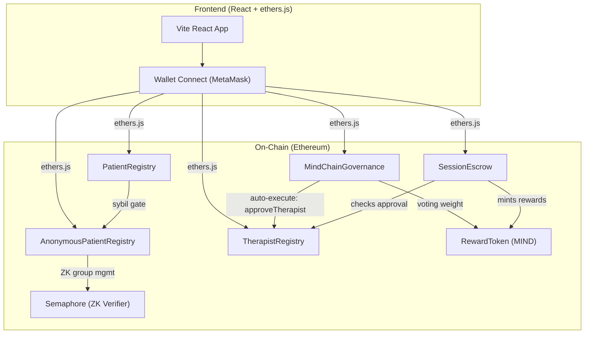

# MindChain DAO

A blockchain-based, privacy-preserving mental health support platform built on Ethereum.
Patients log mental health journeys anonymously using zero-knowledge proofs, verified
therapists earn token rewards for sessions, and a DAO governs therapist verification
and platform policy.

Aligned with **SDG 3: Good Health and Well-Being**.

## Problem

Existing mental health support systems suffer from:
- Lack of privacy and fear of disclosure to institutions
- Fragmented, non-portable mental health records
- No mechanism for peer-based support validation
- Therapist shortage and long wait times

## Solution

- **Zero-knowledge anonymous journaling** — patients prove group membership without revealing their wallet address (Semaphore ZK proofs)
- Verified therapists log support sessions immutably on-chain
- Therapists earn MIND tokens for verified, quality sessions
- Tamper-proof, user-owned mental health records, portable across institutions
- Community (DAO) governance over therapist verification and platform policy — with auto-executing proposals

## Why Ethereum

Ethereum was chosen over Hyperledger because it is public and permissionless (no
gatekeeper institution needed), has native token support for the reward model, has the
largest audited smart-contract library ecosystem (OpenZeppelin), and has mature tooling
(Hardhat, Etherscan) for testing, deployment, and verification — all important for a
project handling sensitive health data.

## Architecture



Three layers:
1. **On-chain (Ethereum):** Identity, permissions, session records, token balances, DAO
   votes, and ZK anonymous journal hashes — anything that must be permanent and tamper-proof.
2. **Off-chain storage (planned):** Encrypted journal entries on IPFS (too large/sensitive
   for on-chain storage). Currently only content hashes are stored on-chain.
3. **Frontend:** The UI the user interacts with. No usernames or passwords — a connected
   wallet address is the user's identity.

## Smart Contracts

| Contract | Description |
|---|---|
| `PatientRegistry.sol` | Register as a patient, log journal entries (hash-only on-chain) |
| `AnonymousPatientRegistry.sol` | ZK anonymous journaling via Semaphore — prove you're a patient without revealing which one |
| `TherapistRegistry.sol` | Apply, approve/reject therapists; `transferAdmin()` to hand control to DAO |
| `SessionEscrow.sol` | Book sessions with ETH escrow, confirm/cancel, 7-day timeout, ReentrancyGuard |
| `RewardToken.sol` | ERC20 "MIND" token — minted only by SessionEscrow on confirmed sessions |
| `MindChainGovernance.sol` | DAO proposals (simple + executable), weighted voting, auto-execution |
| `SemaphoreImports.sol` | Import shim for Semaphore protocol artifacts |

## Project Status

| Feature | Status |
|---|---|
| Patient & Therapist registry contracts | ✅ Complete |
| Session escrow + token reward contract | ✅ Complete |
| DAO governance with executable proposals | ✅ Complete |
| Zero-knowledge anonymous identity (Semaphore) | ✅ Complete |
| Session timeout + reentrancy protection | ✅ Complete |
| Admin transfer to DAO | ✅ Complete |
| Frontend wallet connect + all panels | ✅ Complete |
| Full test suite (54 tests) | ✅ All 54 passing |
| Frontend browser-side ZK proof generation (Semaphore v4) | ✅ Complete |
| Client-side AES-GCM 256 encryption + IPFS storage (CIDv1) | ✅ Complete |
| Threat model, audit analysis & security policy (SECURITY.md) | ✅ Complete |

## Tech Stack

- **Solidity** ^0.8.24
- **Hardhat** (compile, test, deploy)
- **OpenZeppelin** (ERC20, Ownable, ReentrancyGuard)
- **Semaphore Protocol** v4 (`@semaphore-protocol/identity`, `@semaphore-protocol/proof`, `@semaphore-protocol/group`)
- **Web Crypto API** (Client-side AES-GCM 256-bit authenticated encryption)
- **IPFS & multiformats** (Decentralized content-addressable storage, CIDv1)
- **React 19 + Vite** (frontend)
- **ethers.js** v6 (blockchain interaction)
- **Ethereum** (Sepolia testnet / local Hardhat node)

## Getting Started

```bash
# Install dependencies
npm install

# Copy environment config
cp .env.example .env   # fill in your own RPC URL / private key / Etherscan key

# Compile contracts
npx hardhat compile

# Run tests (54 tests)
npx hardhat test
```

## Deploy & Demo

### Local deployment (Hardhat node)

```bash
# Terminal 1: Start local blockchain
npx hardhat node

# Terminal 2: Deploy all contracts + wire dependencies
npx hardhat run scripts/deploy-all.js --network localhost

# Terminal 3: Seed demo data (register patient, approve therapist, book session, etc.)
npx hardhat run scripts/demo-seed.js --network localhost

# Terminal 4: Export ABIs to frontend
npx hardhat run scripts/export-abis.js

# Terminal 5: Start frontend
cd frontend
npm install
npm run dev
```

### Demo walkthrough

1. **Connect wallet** — open the frontend and connect MetaMask (Hardhat network, chain ID 1337)
2. **Register as patient** — click "Register as Patient" in the Patient panel
3. **Apply as therapist** — switch to a different MetaMask account, click "Apply as Therapist"
4. **Approve therapist** — switch to the deployer account (admin), approve the application
5. **Book a session** — as the patient, enter the therapist's address and pay a fee in ETH
6. **Confirm session** — switch to the therapist account, confirm the session (gets paid + earns MIND tokens)
7. **Create DAO proposal** — any MIND holder can create a proposal (simple or executable)
8. **Vote & finalize** — vote on the proposal, wait for the voting period, finalize
9. **Execute** — if the proposal passed and is executable, click "Execute On-Chain" to auto-approve a therapist via DAO vote

### Sepolia testnet deployment

```bash
npx hardhat run scripts/deploy-all.js --network sepolia
```

## Scripts

| Script | Purpose |
|---|---|
| `scripts/deploy-all.js` | Deploy all contracts with correct wiring |
| `scripts/demo-seed.js` | Seed demo data for local testing |
| `scripts/export-abis.js` | Export contract ABIs to `frontend/src/contracts/` |
| `scripts/deploy.js` | Simple single-contract deploy (legacy) |

## Project Timeline

- **Days 1–4:** Smart contract development (Patient, Therapist, Session, Governance, RewardToken)
- **Days 5–6:** Frontend development (React + ethers.js, 5 interactive panels)
- **Day 7:** Documentation and cleanup
- **Day 8:** Architecture design for advanced features
- **Days 9–10:** Semaphore ZK anonymous identity implementation (8 ZK tests)
- **Days 13–14:** DAO auto-execution, session timeout, ReentrancyGuard, admin transfer, test hardening

## Security Notes

This is a development/demo project. Known limitations for production use:

- **Voting uses live `balanceOf()`** — a voter could transfer tokens and vote again from another wallet. Production needs snapshot-based voting (ERC20Votes).
- **No quorum requirement** — a single token holder can pass a proposal if nobody votes against.
- **No time-lock on execution** — `executeProposal()` fires immediately. Production DAOs use time-lock delays.
- **Single-step admin transfer** — consider a 2-step (propose → accept) pattern for production.

## License

MIT

